# Display Media Titles for FYT 7862/8581/7870 + universal music widget

Android app for FYT 7862/8581/7870 displaying media titles on status bar. App also offers an universal music widget. It displays also artist name if it's present in the metadata. Should work on Android 8 and above. The app was tested on Android 10 on FYT UIS7862 and on Android 15 on phone. Display Media Titles should work on most of the devices, however it was created exclusively for FYT 7862/8581 so it might misbehave on other devices.

App works with the players that use MediaController which means that it should get along with most of the available music apps. 

It also supports original FYT player - see the `Displaying media titles from stock FYT's music player` caption.

## Installation

App requires six permissions:
* Notification access to be able to read media metadata.
* Display over other apps to properly display titles.
* Battery optimization to keep service alive.
* Phone state to properly remove view on phone calls.
* Call logs to open app with the dialer's "secret code".
* Storage to use the file picker and .ttf fonts.

Check this [tutorial](https://www.youtube.com/watch?v=H3tnNVyCJfk) in case you have a problem with Restricted Setting pop-up (for non-system apps).

* Standard variant (non-system app; works on phones, tablets and FYT units, including those whose firmware is not signed with the platform key, such as the FYT 7870):

	Download and install `display_media_titles_standard.apk` file (called `display_media_titles_phone.apk` up to version 1.1.2; the package name is still `vasyl.titles.phone`, so it installs as an update of the old file). This version due to android restrictions will display titles only if the launcher has a fully transparent status bar, on FYT it might look like there's a shadow on it (it's probably hardcoded, the shadow persists regardless the launcher type/mod).
	User will be prompted to grant permissions mentioned before on the first start. 
	
* System variant (uses system permissions to display the titles above the status bar; needs firmware signed with the platform key, e.g. FYT 7862/8581, so it cannot be installed on the FYT 7870):
	
	- FYT 7862/8581:

		Which installer should you choose? See the `Displaying media titles from stock FYT's music player` caption and choose the variant that suits you.
		Download `installer_xxx.zip`, unpack it in a FAT32 formatted USB pendrive, then connect pendrive to your unit's USB port and wait, installation should start after few seconds.
		Works with every launcher and displays media data on top of everything (no shadow issue).
		Permissions for system apps should be granted automatically.
		
		Use `uninstaller_xxx.zip` to remove the app.

	- Other devices using standard Google keystore:

		Install any `.apk` from `installer\_displaymediatitles\package.name` and [convert it to system app](https://www.google.com/search?client=firefox-b-d&q=how+to+convert+app+to+stsyem).

* Opening app interface:

	This app aims to work in the background therefore it minimizes after having all permissions granted and unchecked "Display UI" CheckBox. I made this function in case it's necessary to mark the app in the FYT system settings as the one that's meant to run at the device boot/wake from sleep. Might be also useful while using in-app autostart option. 
	
	To get the application's view after unchecking "Display UI" CheckBox, please open the dialer and type `*#*#3368#*#*` (if it doesn't work with your stock dialer then install [Phone by Google](https://play.google.com/store/apps/details?id=com.google.android.dialer&hl=en_US)), the app should open it's MainActivity. It is also possible to have the same effect by revoking one of the permissions or in case of non-system app, not to grant it on the first start  (i.e. display over other apps - remember to grant it back to see the result). Revoking notification access might result in the app's crash. User will be able to grant previously revoked permission by pressing according button which glares red if permission is denied.

* Setting view parameters:

	Very simple and intuitive layout allows user to set the left margin and width of the view depending on the device display width. It also provides following features: caption height, font size, color and typeface, background color, .ttf fonts. Try it with long titles for proper setting.

	- .ttf fonts:
	
		If you encounter `Storage Access Framework is currently not available` toast, then please install [DocumentsUI-10.apk](https://github.com/vasyl91/Display-Media-Titles/releases/download/v1.0.8/DocumentsUI-10.apk) (credit to [FYTuis7862BinRepo](https://github.com/hvdwolf/FYTuis7862BinRepo) by [hvdwolf](https://github.com/hvdwolf)).
		
		DocumentsUI-10.apk is meant for FYT devices and probably won't get along with phones. If you encounter it on the phone you'll have to find according app yourself.
		
		[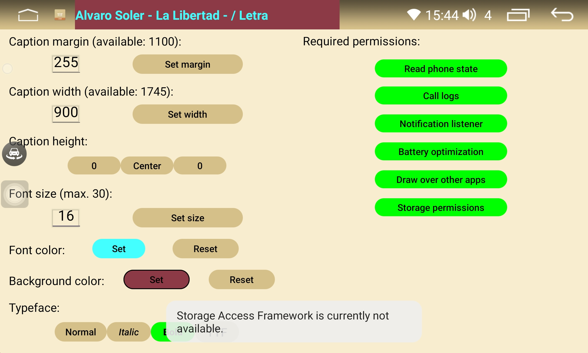](./images/11.png)
		
		If you pick up the font .ttf on the phone and everything seems to be fine but eventually the font isn't loaded then make sure that you're using the stock file manager (com.google.android.documentsui) and allow the app to `Change system settings`.

* Displaying media titles from stock FYT's music player (FYT 7862/8581, `com.syu.music`):

	FYT manufacturers have designed connection between the stock music app (com.syu.music) and the target apps (current default launcher and few more - probably specific to the music app version) that depends on intents adressed for specific package. That means that there is no way to directly intercept the existing message. Fortunately I found few workarounds. 

	First method is a proxy launcher with an extra broadcast that receives and forwards the intents mentioned above to any app that has registered a specific receiver. And you can find such receiver in Display Media Titles.
	This method has a major limitation because it needs a modified launcher (you can use existing one or modify it by yourself - see below).

	Second method depends on changing the Display Media Titles' package name to the one that is adressed by the stock music player. This doesn't require any modifications however it might happen that you won't be able to install the app under specific package (listed below) if you already have such package installed on your FYT device. To reduce such probability the app comes in few variants with different package names.
	
	List of available packages:
	- `vasyl.titles` (this is the original name, second method won't work with that)
	- `com.syu.widget.music`
	- `com.syu.screensaver`
	- `com.ava.car`
	- `cn.teyes.online`

	Always check if the package you have chosen is not already installed! Other way you can mess your unit. 

* Displaying media titles from the stock sources of the FYT 7870:

	On the FYT 7870 the stock player is `com.syu.media`. Display Media Titles reads it directly, so neither a modified launcher nor one of the package variants above is needed. Its firmware is not signed with the platform key, so use the standard variant (`display_media_titles_standard.apk`); it needs no storage access for this.

	What is shown (only while it actually plays; paused or stopped means no title):
	- music played by `com.syu.media` (local files and USB): title and artist as the player reports them, or the file name with the `File name` setting,
	- internet radio of `com.syu.media`: the station's name,
	- FM / AM radio: the station's RDS name, otherwise its frequency,
	- Bluetooth audio from the phone: title and artist, when the phone sends them.

	The widget's buttons control these sources: previous / play-pause / next for the music and internet radio players, the phone over BT and the radio (next / previous station of its list; play-pause switches the radio on and off). A tap on the widget opens the source's page in the stock media app; so does a button when the source is not running, as the app never starts one by itself. The title on the status bar only shows what plays.

	Limitations: the covers of radio stations and of Bluetooth songs are not shown. The FYT 7870 is recognised by its chipset; other units keep working as before.

## Generating app in Android Studio

Clone repository and use `keystore.jks` located in `Display-Media-Titles\app`. Choose exisiting android key alias with password `android`. 
For non-system app remove `android:sharedUserId="android.uid.system"` from `AndroidManifest.xml`.

FYT 7862/8581 uses standard Google keystore, if you want to generate app that will work as a system app on OS that has been signed with different keystore then make sure to use that keystore.

## Gallery

[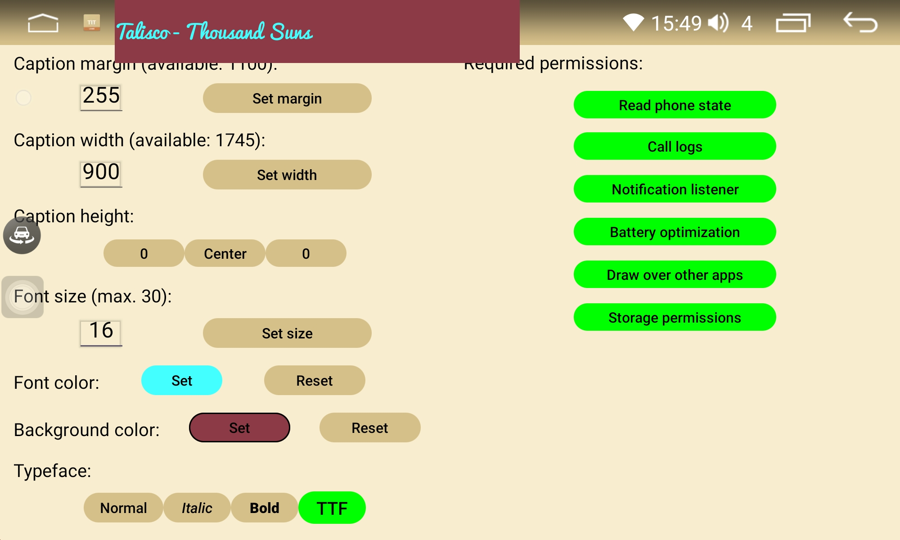](./images/10.png)[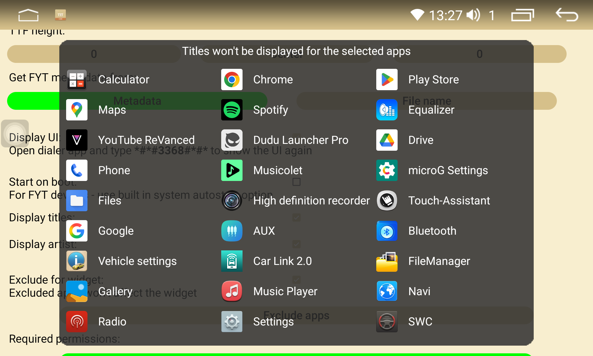](./images/3a.png)
[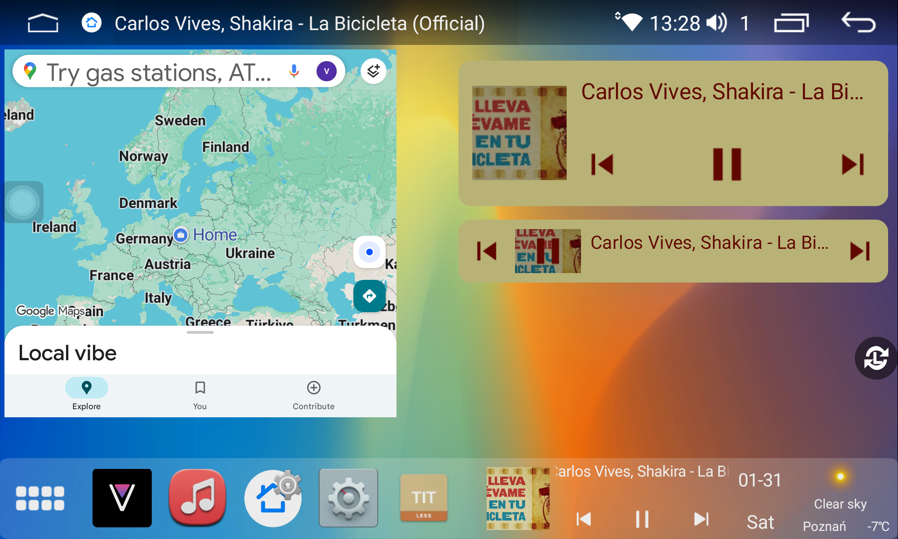](./images/4.png)[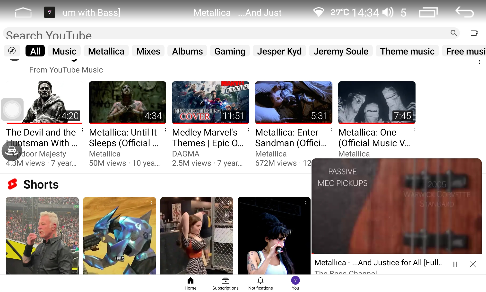](./images/5.png)
[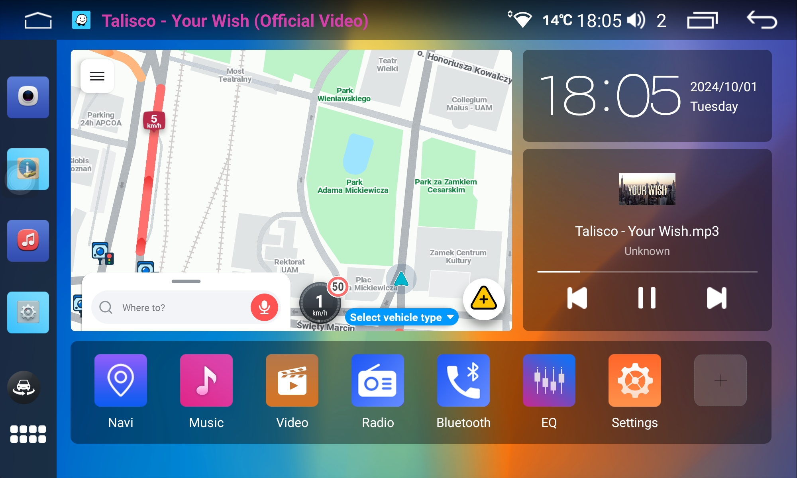](./images/6.png)[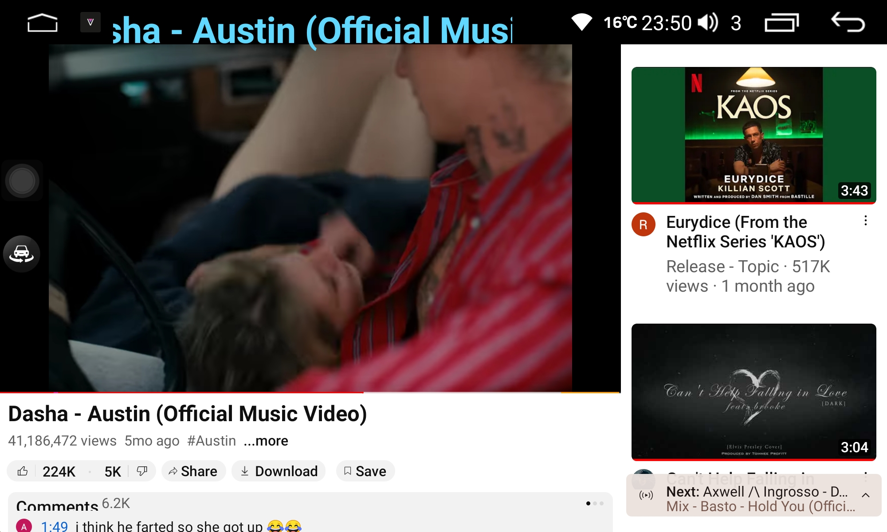](./images/7.png)
[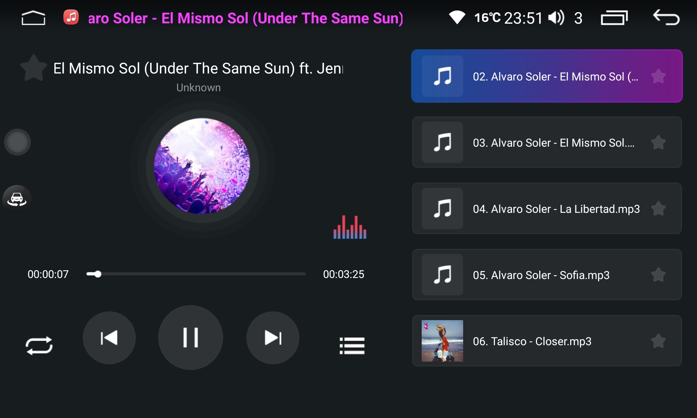](./images/8.png)[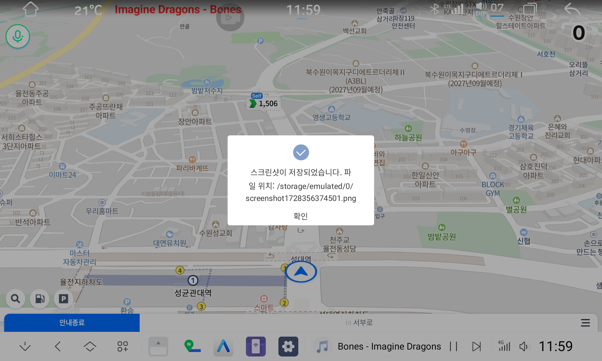](./images/9.png)
[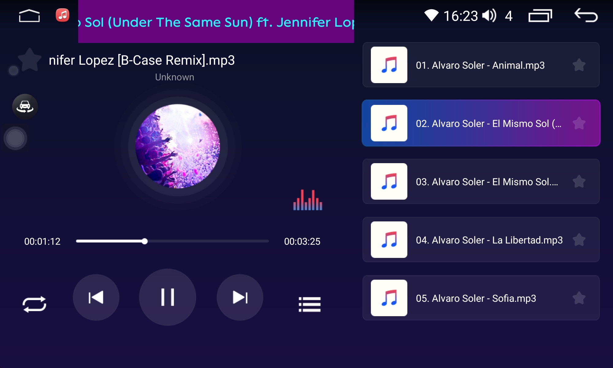](./images/12.png)[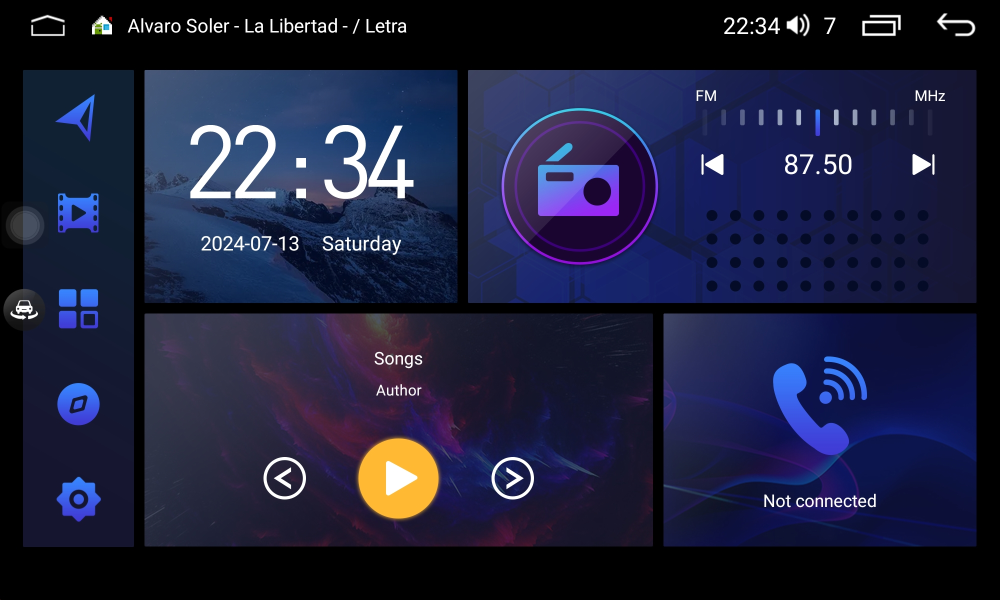](./images/3.png)

## Modified Launchers allowing to display stock player media data

**[HERE](./launcher_cooker/README_LAUNCHER.md) is a full guide how to easily modify most of the existing launchers.**

### Universal launcher for any resolution and ortientation

* [launcher66](https://github.com/vasyl91/FYT-Launcher-Mod)

### 2000x1200

* [launcher29](https://github.com/vasyl91/DisplayMediaTitles/releases/download/launchers/2000x1200_launcher29_installer.rar)

	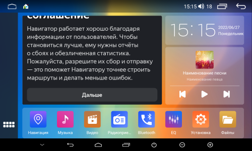

* [launcher34](https://github.com/vasyl91/DisplayMediaTitles/releases/download/launchers/2000x1200_launcher34_installer.rar)

	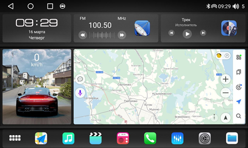

* [launcher34_front_app_mod](https://github.com/vasyl91/DisplayMediaTitles/releases/download/launchers/2000x1200_launcher34__front_app_mod_installer.rar)

	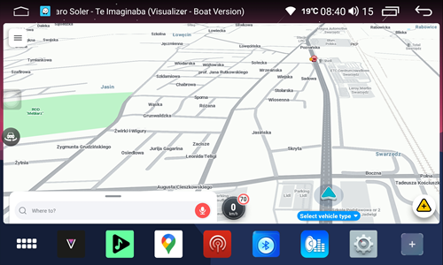

### 1920x720

* [launcher6](https://github.com/vasyl91/DisplayMediaTitles/releases/download/launchers/1920x720_launcher6_installer.rar)

	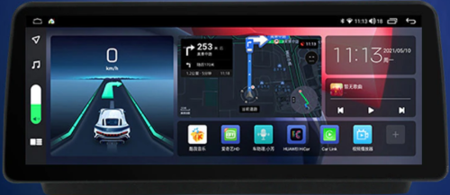

* [launcher13](https://github.com/vasyl91/DisplayMediaTitles/releases/download/launchers/1920x720_launcher13_installer.rar)

	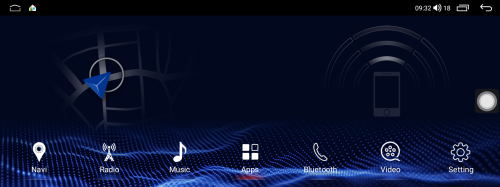

### 1280x720, 1024x600 

* [launcher17](https://github.com/vasyl91/DisplayMediaTitles/releases/download/launchers/1280x720_1024x600_launcher17_installer.rar)

	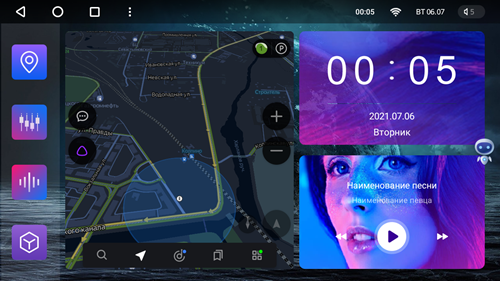

* [launcher29](https://github.com/vasyl91/DisplayMediaTitles/releases/download/launchers/1280x720_1024x600_launcher29_installer.rar)

	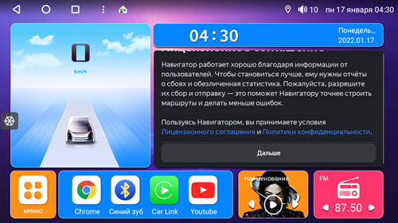

### XDA lauchers from this [thread](https://xdaforums.com/t/modded-fyt-launcher-34-for-uis7862-s-and-uis8581a-and-probably-uis8514a.4618337/)

* [190001034_com.android.launcherBottomMap](https://github.com/vasyl91/DisplayMediaTitles/releases/download/launchers/190001034_com.android.launcherBottomMap_installer.rar)

* [BottomBar2Left-190001034_com.android.launcher34](https://github.com/vasyl91/DisplayMediaTitles/releases/download/launchers/BottomBar2Left-190001034_com.android.launcher34_installer.rar)

* [OnlyBottomAppBar_190001034_com.android.launcher34](https://github.com/vasyl91/DisplayMediaTitles/releases/download/launchers/OnlyBottomAppBar_190001034_com.android.launcher34_installer.rar)

* [OnlyLeftAppBar_190001034_com.android.launcher34](https://github.com/vasyl91/DisplayMediaTitles/releases/download/launchers/OnlyLeftAppBar_190001034_com.android.launcher34_installer.rar)
